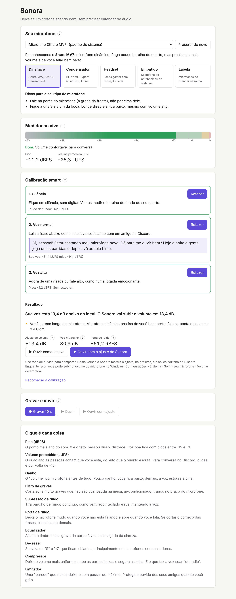

# Sonora

Sonora deixa qualquer microfone com som de qualidade no Discord, OBS, jogos e chamadas, sem precisar entender de áudio.

O app detecta o seu microfone, mede o seu quarto, calibra tudo sozinho e explica cada ajuste em palavras simples.



## Status

Fase 1 (protótipo para Windows):

- Escolher o microfone e reconhecer o tipo (dinâmico, condensador, headset, embutido, lapela).
- Medidor ao vivo de pico (dBFS) e volume percebido (LUFS, padrão EBU R128).
- Calibração smart em 3 testes: silêncio, voz normal e voz alta, com a recomendação de ajuste.
- Gravar e ouvir de volta, com e sem o ajuste sugerido.
- Explicação de cada termo de áudio.

Próxima fase: a cadeia de som completa (filtro, supressão e porta de ruído, equalizador, compressor, limitador) aplicada direto no Discord por um microfone virtual. Depois, versão para Mac.

## Baixar e testar (Windows)

1. Abra a aba **Actions** do repositório e escolha a execução mais recente do **CI** que passou.
2. Em **Artifacts**, baixe `Sonora-Windows-instalador` e descompacte.
3. Rode o instalador. Como o app ainda não tem assinatura digital, o Windows mostra "O Windows protegeu o computador": clique em **Mais informações** e **Executar assim mesmo**.
4. Se o microfone não aparecer, confira em Configurações › Privacidade e segurança › Microfone se "Permitir que aplicativos da área de trabalho acessem o microfone" está ligado.

## Para desenvolver

Precisa de [Rust](https://rustup.rs) e [Node.js 22](https://nodejs.org).

```sh
npm install
npm run tauri dev      # abre o app em modo de desenvolvimento
cargo test --workspace # testes do núcleo de áudio
npm run tauri build    # gera o instalador
```

Estrutura:

- `crates/sonora-dsp`: medição, calibração, detecção de microfone e processamento. Não depende de placa de som, então é todo testável.
- `src-tauri`: o app desktop (Tauri 2). Abre o microfone com `cpal`, alimenta o núcleo e conversa com a tela.
- `src`: a tela, em React + TypeScript. Os textos explicativos ficam em `src/texts.ts`.

## Licença

Código aberto, sob a licença [MIT](LICENSE).
