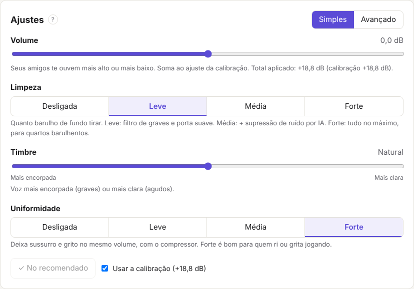

# Sonora

Sonora deixa qualquer microfone com som de qualidade no Discord, OBS, jogos e chamadas, sem precisar entender de áudio.

O app detecta o seu microfone, mede o seu quarto, calibra tudo sozinho e explica cada ajuste em palavras simples.



## Como funciona

O tratamento roda **dentro do sistema de áudio do Windows**, preso ao microfone. Todos os programas (Discord, jogos, OBS, navegador) recebem a voz tratada, mesmo com o Sonora fechado. Nada fica rodando em segundo plano: o processamento só acontece quando algum programa usa o microfone, e gasta cerca de 1% de um núcleo do processador.

Para isso o Sonora usa o [Equalizer APO](https://sourceforge.net/projects/equalizerapo/) (gratuito e de código aberto) como "tomada" e pluga nele o seu próprio módulo (`sonora_vst.dll`) com a cadeia de som:

ganho → filtro de graves → supressão de ruído (RNNoise) → porta de ruído → equalizador → de-esser → compressor → limitador

O app é só a tela de configuração: escreve os números na configuração do Equalizer APO, que recarrega sozinho.

## O que o app faz

- Reconhece o microfone e o tipo dele (dinâmico, condensador, headset, embutido, lapela) e sugere ajustes para cada tipo.
- Calibração smart em 3 testes (silêncio, voz normal, voz alta). O resultado é só uma sugestão: você decide se usa.
- **Modo simples**: Volume, Limpeza, Timbre e Uniformidade.
- **Modo avançado**: cada efeito liga e desliga e todos os números são editáveis, com explicação de para que serve e quando mexer.
- Medidor ao vivo (pico e LUFS), gravar e ouvir de volta, com prévia do tratamento.
- Liga e desliga o tratamento no Windows com um clique.

Próximo: versão para Mac.

## Baixar e testar (Windows)

1. Abra a aba **Actions** do repositório e escolha a execução mais recente do **CI** que passou.
2. Em **Artifacts**, baixe `Sonora-Windows-instalador` e descompacte.
3. Rode o instalador. Como o app ainda não tem assinatura digital, o Windows mostra "O Windows protegeu o computador": clique em **Mais informações** e **Executar assim mesmo**.
4. Se o microfone não aparecer, confira em Configurações › Privacidade e segurança › Microfone se "Permitir que aplicativos da área de trabalho acessem o microfone" está ligado.
5. Siga o card "Ligar no Windows" do app: instalar o Equalizer APO, marcar o microfone em "Capture devices", reiniciar o PC e clicar em "Ativar o Sonora no Windows".

## Para desenvolver

Precisa de [Rust](https://rustup.rs) e [Node.js 22](https://nodejs.org).

```sh
npm install
npm run tauri dev      # abre o app em modo de desenvolvimento
cargo test --workspace # testes do núcleo de áudio
npm run tauri build    # gera o instalador
```

Estrutura:

- `crates/sonora-dsp`: medição, calibração, detecção de microfone, presets e a cadeia de som. Não depende de placa de som, então é todo testável.
- `crates/sonora-vst`: o módulo VST2 que o Equalizer APO carrega dentro do Windows. Lê os ajustes como parâmetros com nome. `cargo run --release -p sonora-vst --example host_check -- <módulo>` carrega o módulo como um host faria.
- `src-tauri`: o app desktop (Tauri 2). Abre o microfone com `cpal`, calibra, grava e escreve a configuração do Equalizer APO (`eqapo.rs`).
- `src`: a tela, em React + TypeScript. Os textos explicativos ficam em `src/texts.ts`.

## Licença

Código aberto, sob a licença [MIT](LICENSE).
